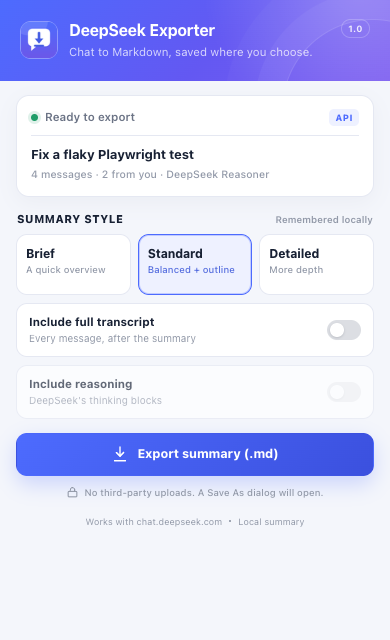

# DeepSeek Chat Exporter

A Brave (and Chrome/Chromium) extension that turns the DeepSeek conversation you have open into a clean Markdown **summary** — then opens the native **Save As** dialog so you choose exactly where the `.md` file goes.

Nothing is uploaded to a third party. There is no API key, no account, no analytics, and no server component.



## What it does

- **One-click summary** of the current `chat.deepseek.com` conversation.
- **Three levels** — Brief, Standard, Detailed.
- **Optional full transcript** after the summary, with fenced code blocks, links and attachments preserved.
- **Optional reasoning blocks** (off by default; can contain sensitive chain-of-thought).
- **Native Save As dialog** via `chrome.downloads.download({ saveAs: true })`. The file is written wherever you choose.
- **Reads the active branch only** — if you edited a prompt or regenerated an answer, the export follows the branch currently shown, not discarded alternatives.
- **API first, DOM fallback** — normally uses DeepSeek's own `history_messages` data; if that changes, it reads the rendered conversation instead.

Example output: [docs/example-export.md](docs/example-export.md)

## Install in Brave

1. Download or clone this repository.
2. Open `brave://extensions`.
3. Turn on **Developer mode** (top-right).
4. Click **Load unpacked**.
5. Select the [`extension/`](extension/) folder itself — the one containing `manifest.json`, **not** the repository root.
6. Open a conversation on [chat.deepseek.com](https://chat.deepseek.com/).
7. Click the download-bubble icon in the toolbar, or press **Alt+Shift+D** on Windows/Linux or **Option+Shift+D** on macOS.

After updating or reinstalling the extension, reload an already-open DeepSeek tab once. The popup can inject the content script into a tab that was open before installation, but reloading is the most reliable path.

## Use

1. Open the conversation you want.
2. Click the extension icon.
3. Pick a summary style:
   - **Brief** — a quick overview and a few takeaways.
   - **Standard** — balanced takeaways plus a question-by-question outline.
   - **Detailed** — more key points and a longer turn-by-turn outline.
4. Optionally enable **Include full transcript** and **Include reasoning**.
5. Click **Export summary (.md)**.
6. Choose a location in the Brave/Chrome Save As dialog.

The extension also includes a **Save As** prompt if Chrome/Brave is configured to download automatically; `saveAs: true` is passed explicitly.

## What “summary” means

The summary engine is **local and extractive**. It does not call an LLM. It scores the assistant's sentences using TF‑IDF, topic overlap with your questions, structural signals and redundancy checks, then assembles:

- an at-a-glance main question / bottom-line / topic block (one-off asides are left to the outline),
- key points,
- a question-by-question outline,
- action items,
- code and attachment inventory,
- links mentioned.

This keeps the extension private, instant and API-key-free, but it is not an abstractive AI rewrite. Headings from the answer are kept as context, quotations are closed rather than cut mid-sentence, and a one-off side question is left to the outline instead of becoming the headline or a key point. Use **Include full transcript** when you need every detail.

## Privacy

- The conversation is read in the content script and summarized in memory.
- It is sent only to the extension's own service worker and offscreen page in the same browser.
- The only network request is to `https://chat.deepseek.com/api/v0/chat/history_messages` on the tab's own origin, using the session you are already signed in with. If that request fails, the page is read from the DOM.
- Settings (summary style and toggles) are stored in `chrome.storage.local`.
- No chat content is persisted by the extension.
- The extension does not request access to other sites.

## Permissions

| Permission | Why |
| --- | --- |
| `host_permissions: https://chat.deepseek.com/*` | Read the conversation you are viewing. |
| `activeTab`, `scripting` | Connect to the current DeepSeek tab (and inject the content script after install if the tab was already open). |
| `downloads` | Start the Markdown download with the native Save As dialog. |
| `offscreen` | Create a Blob URL for the Markdown; MV3 service workers cannot create Blob URLs themselves. |
| `storage` | Remember your summary style and toggles locally. |

## Limitations

- Exports the **currently open conversation**, one at a time. Bulk history export is not included.
- DeepSeek changes its web app regularly. The API is preferred, with a DOM fallback for continuity, but both can need selector updates after a major redesign.
- Attachments are linked by their DeepSeek URL; they are not embedded or downloaded.
- The extractive summary can miss nuance, especially in very long chats. Detailed mode + transcript is the high-fidelity option.
- The native Save As dialog is browser UI, so the extension popup may close while it is open. That is expected.

## Development

Requirements: Node.js 20+ and Brave or Chrome. The integration test looks for Brave in the usual macOS/Linux/Windows locations; set `BRAVE_PATH` to override the executable path.

```bash
npm install
npm test          # unit tests
npm run test:e2e  # Brave integration test against a mocked DeepSeek page
npm run package   # builds dist/deepseek-chat-exporter-1.0.0.zip
```

The integration test covers:

- DeepSeek API branch selection (discarded regenerations excluded),
- Markdown summary, transcript, reasoning, code, files and links,
- the full `EXPORT_AND_SAVE` → offscreen Blob → `chrome.downloads` path,
- DOM fallback when the API returns an error,
- the popup UI.

## Project layout

```text
extension/
  manifest.json
  background.js       service worker + download coordinator
  content.js          DeepSeek API/DOM reader and exporter
  popup.html/css/js   toolbar UI
  offscreen.html/js   Blob URL factory
  lib/shared.js       token/URL/filename helpers
  lib/markdown.js     HTML → Markdown for DOM fallback
  lib/summarize.js    local extractive summary + Markdown writer
  icons/
tests/                unit + Brave integration tests, fixtures, artifacts
docs/                 screenshot and example export
scripts/package.sh    builds the distributable zip
```

## License

MIT
